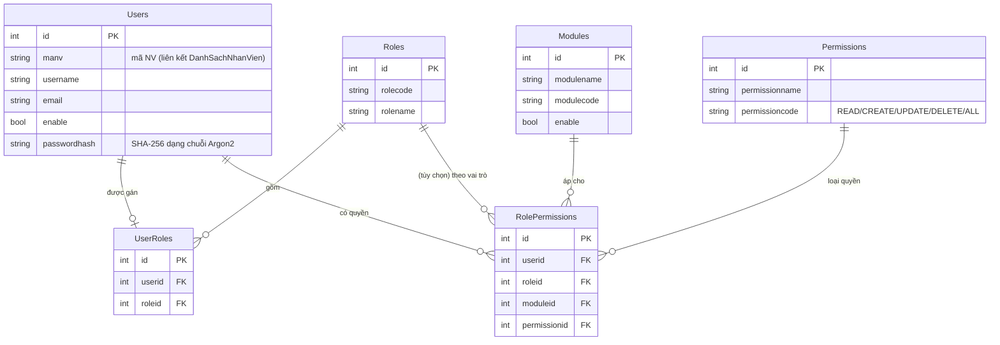

# ERD – PHÂN TÍCH DỮ LIỆU & SƠ ĐỒ THỰC THỂ QUAN HỆ
## Hệ thống Quản lý Nhân sự – Trường Đại học Kiến trúc Đà Nẵng

| | |
|---|---|
| **Mã tài liệu** | ERD-DAU-HRM-04 |
| **Phiên bản** | 1.0 |
| **Ngày** | 02/07/2026 |
| **CSDL** | PostgreSQL (Supabase) |

---

## 1. Tổng quan mô hình dữ liệu

Hệ thống sử dụng **~40 bảng** trong PostgreSQL, chia thành 6 nhóm:

1. **Bảo mật & phân quyền**: `Users`, `Roles`, `UserRoles`, `Modules`, `Permissions`, `RolePermissions`.
2. **Nhân sự lõi**: `DanhSachNhanVien`, `DanhSachQuanHeGiaDinh`, `DanhSachQuaTrinhDaoTao`, `DanhSachHocTapNangCaoTrinhDo`.
3. **Danh mục dùng chung**: `DanhMucTrinhDo`, `DanhMucChucDanh`, `DanhMucChucVu`, `DanhMucPhongBan`, `DanhMucNamHoc`, `DanhMucToBoMon`, `DanhMucHDLD`, `DanhMucHSL`, `DanhMucBenhVien`, `DanhMucMucDoHTNV`, `DanhMucDanhHieuThiDua`, `DanhMucHinhThucKhenThuong`, `DanhMucNganhDaoTao`.
4. **Tổ chức**: `DanhSachNhanSuBoMon`, `DanhSachGVNganhDaoTao`.
5. **HĐLĐ / Lương / Bảo hiểm**: `DanhSachKyHDLD`, `DanhSachHSL`, `DanhSachNghiKhongLuong`, `ThongTinBaoHiemHangThang`, `ThongTinBaoHiemCaNhan`, `QuaTrinhDongBaoHiem`.
6. **Thi đua – Khen thưởng – Công phép**: `DanhSachCaNhanHTNV`, `DanhSachTapTheHTNV`, `DanhSachCaNhanDHTD`, `DanhSachTapTheDHTD`, `DanhSachCaNhanKhenThuong`, `DanhSachTapTheKhenThuong`, `DanhSachNghiPhepNam`, `DanhSachNgayNghiLe`.

**Trục trung tâm**: `DanhSachNhanVien` liên kết tới hầu hết các bảng nghiệp vụ qua khóa nghiệp vụ **`manv`** (mã nhân viên). Các bảng danh mục cung cấp nhãn hiển thị (được join phía client bằng mã như `matrinhdo`, `maphongban`, `machucvu`, `machucdanh`).

> **Lưu ý phân tích**: Quan hệ được thực thi chủ yếu ở **tầng ứng dụng** (join trên client theo mã), không nhất thiết có khóa ngoại ràng buộc cứng trong DB. ERD dưới đây mô hình hóa quan hệ **logic nghiệp vụ**.

## 2. Sơ đồ ERD – Nhóm bảo mật & phân quyền (RBAC)



## 3. Sơ đồ ERD – Nhân sự lõi & danh mục tổ chức

```mermaid
erDiagram
    DanhMucPhongBan   ||--o{ DanhSachNhanVien : "phongban"
    DanhMucTrinhDo    ||--o{ DanhSachNhanVien : "trinhdo"
    DanhMucChucVu     ||--o{ DanhSachNhanVien : "chucvu"
    DanhMucChucDanh   ||--o{ DanhSachNhanVien : "chucdanh"
    DanhSachNhanVien  ||--o{ DanhSachQuanHeGiaDinh : "manv"
    DanhSachNhanVien  ||--o{ DanhSachQuaTrinhDaoTao : "manv"
    DanhSachNhanVien  ||--o{ DanhSachHocTapNangCaoTrinhDo : "manv"
    DanhMucPhongBan   ||--o{ DanhMucToBoMon : "tructhuoc"
    DanhMucToBoMon    ||--o{ DanhSachNhanSuBoMon : "masobomon"
    DanhSachNhanVien  ||--o{ DanhSachNhanSuBoMon : "manv"
    DanhMucNganhDaoTao||--o{ DanhSachGVNganhDaoTao : "nganhdaotao"
    DanhSachNhanVien  ||--o{ DanhSachGVNganhDaoTao : "manv"

    DanhSachNhanVien {
        int id PK
        string manv UK "mã nhân viên"
        string holot
        string ten
        bool gioitinh
        string ngaysinh
        string socccd
        string phongban FK
        string chucvu FK
        string chucdanh FK
        string trinhdo FK
        bool giangvien
        bool danghiviec
        string ngaychinhthuc
        string hinhanh
    }
    DanhMucPhongBan { int id PK; string maphongban UK; string giatri; int sapxep }
    DanhMucTrinhDo  { int id PK; string matrinhdo UK; string giatri }
    DanhMucChucVu   { int id PK; string machucvu UK; string giatri }
    DanhMucChucDanh { int id PK; string machucdanh UK; string giatri }
    DanhMucToBoMon  { int id PK; string mabomon UK; string giatri; string tructhuoc FK }
    DanhMucNganhDaoTao { int id PK; string manganh UK; string tennganh; string khoinganh }
    DanhSachNhanSuBoMon { int id PK; string manv FK; string masobomon FK; int vithubomon }
    DanhSachGVNganhDaoTao { int id PK; string manv FK; string nganhdaotao FK }
    DanhSachQuanHeGiaDinh { int id PK; string manv FK; string moiquanhe; string namsinh }
    DanhSachQuaTrinhDaoTao { int id PK; string manv FK; string trinhdodaotao; string chuyennganh }
    DanhSachHocTapNangCaoTrinhDo { int maso PK; string manv FK; string trinhdohoctapnangcao }
```

## 4. Sơ đồ ERD – HĐLĐ, Lương, Bảo hiểm

```mermaid
erDiagram
    DanhMucHDLD       ||--o{ DanhSachKyHDLD : "loaihd"
    DanhSachNhanVien  ||--o{ DanhSachKyHDLD : "manv"
    DanhMucHSL        ||--o{ DanhSachHSL : "quy tắc ngạch/bậc"
    DanhSachNhanVien  ||--o{ DanhSachHSL : "manv"
    DanhSachNhanVien  ||--o{ DanhSachNghiKhongLuong : "manv"
    DanhSachNhanVien  ||--o{ ThongTinBaoHiemCaNhan : "manv"
    DanhMucBenhVien   ||--o{ ThongTinBaoHiemCaNhan : "noidangkykcb"
    DanhSachNhanVien  ||--o{ QuaTrinhDongBaoHiem : "manv"
    ThongTinBaoHiemHangThang ||..o{ QuaTrinhDongBaoHiem : "tỉ lệ áp dụng theo thangnam"

    DanhSachKyHDLD {
        string idhopdong PK
        string sohd
        string manv FK
        string loaihd FK
        int solan
        string tungay
        string denngay
    }
    DanhMucHDLD { int id PK; string maso UK; string tenhdld; string thoihan }
    DanhSachHSL {
        string manv FK
        string manangluong
        number hsl
        number hschucvu
        number tongheso
        bool dienxet
        string thoigianbatdau
    }
    DanhMucHSL { int maso PK; string loaingachbac; int sonamnangbac; int sobac; number mucnangheso }
    DanhSachNghiKhongLuong { int id PK; string manv FK; string tungay; string denngay; number sothangnghi }
    ThongTinBaoHiemHangThang {
        int maso PK
        string thangnam
        number bhxhtruong
        number bhxhnguoild
        number bhyttruong
        number bhytnguoild
        number bhtntruong
        number bhtnnguoild
        number bhatldtruong
        bool dacosolieu
    }
    ThongTinBaoHiemCaNhan {
        int id PK
        string manv FK
        string sosobaohiem
        int noidangkykcb FK
        bool thaisan
        bool hetthamgia
    }
    QuaTrinhDongBaoHiem {
        int maso PK
        string thangnam
        string manv FK
        number tongheso
        number tienluongphucap
        number bhxh
        number bhyt
        number bhtn
        number bhatld
    }
    DanhMucBenhVien { int maso PK; string tenbenhvien; string diachi }
```

## 5. Sơ đồ ERD – Thi đua, Khen thưởng, HTNV, Công phép

```mermaid
erDiagram
    DanhSachNhanVien ||--o{ DanhSachCaNhanHTNV : "manv"
    DanhSachNhanVien ||--o{ DanhSachCaNhanDHTD : "manv"
    DanhSachNhanVien ||--o{ DanhSachCaNhanKhenThuong : "manv"
    DanhSachNhanVien ||--o{ DanhSachNghiPhepNam : "manv"
    DanhMucNamHoc    ||--o{ DanhSachCaNhanHTNV : "namhoc"
    DanhMucNamHoc    ||--o{ DanhSachCaNhanDHTD : "namhoc"
    DanhMucMucDoHTNV ||--o{ DanhSachCaNhanHTNV : "mucdohtnv"
    DanhMucMucDoHTNV ||--o{ DanhSachTapTheHTNV : "mucdohtnv"
    DanhMucDanhHieuThiDua ||--o{ DanhSachCaNhanDHTD : "danhhieuthidua"
    DanhMucDanhHieuThiDua ||--o{ DanhSachTapTheDHTD : "danhhieuthidua"
    DanhMucHinhThucKhenThuong ||--o{ DanhSachCaNhanKhenThuong : "hinhthuckhenthuong"
    DanhMucHinhThucKhenThuong ||--o{ DanhSachTapTheKhenThuong : "hinhthuckhenthuong"
    DanhMucPhongBan  ||--o{ DanhSachTapTheHTNV : "tendonvi"
    DanhSachNgayNghiLe ||..o{ DanhSachNghiPhepNam : "trừ ngày lễ"

    DanhSachCaNhanHTNV { int id PK; string manv FK; string namhoc FK; string mucdohtnv FK }
    DanhSachTapTheHTNV { int id PK; string tendonvi FK; string namhoc FK; string mucdohtnv FK }
    DanhSachCaNhanDHTD { int id PK; string manv FK; string namhoc FK; string danhhieuthidua FK }
    DanhSachTapTheDHTD { int id PK; string tendonvi FK; string namhoc FK; string danhhieuthidua FK }
    DanhSachCaNhanKhenThuong { int id PK; string manv FK; string namhoc FK; string hinhthuckhenthuong FK }
    DanhSachTapTheKhenThuong { int id PK; string tendonvi FK; string namhoc FK; string hinhthuckhenthuong FK }
    DanhMucMucDoHTNV { int mamucdohtnv PK; string mucdohtnv }
    DanhMucDanhHieuThiDua { int madanhhieu PK; string danhhieuthidua; string capxetduyet }
    DanhMucHinhThucKhenThuong { int makhenthuong PK; string hinhthuckhenthuong; string capxetduyet }
    DanhMucNamHoc { int id PK; string manamhoc UK; string giatri; bool macdinh }
    DanhSachNghiPhepNam { int id PK; string manv FK }
    DanhSachNgayNghiLe { int maso PK; string ngaynghi; string lydonghi }
```

## 6. Từ điển dữ liệu – bảng trọng tâm `DanhSachNhanVien`

| Trường | Kiểu | Mô tả | Ràng buộc/Ghi chú |
|--------|------|-------|-------------------|
| id | int | Khóa chính kỹ thuật | PK |
| manv | string | Mã nhân viên | Khóa nghiệp vụ duy nhất, dùng liên kết mọi phân hệ |
| holot, ten | string | Họ lót, tên | |
| gioitinh | bool | Giới tính (true=Nam) | |
| ngaysinh, noisinh, nguyenquan | string | Thông tin sinh | |
| socccd, ngaycap, noicap | string | CCCD | Dữ liệu nhạy cảm |
| sodtdd, email, noiohiennay | string | Liên hệ | |
| trinhdo | string | Mã trình độ | → `DanhMucTrinhDo.matrinhdo` |
| chucdanh | string | Mã chức danh | → `DanhMucChucDanh.machucdanh` |
| chucvu | string | Mã chức vụ | → `DanhMucChucVu.machucvu` |
| phongban | string | Mã khoa/phòng | → `DanhMucPhongBan.maphongban` |
| giangvien | bool | Là giảng viên | Phục vụ thống kê tỉ lệ GV |
| danghiviec | bool | Đã nghỉ việc | Lọc thống kê & danh sách |
| ngaychinhthuc, ngaythuviec | string | Mốc công tác | |
| ngayqdtrogiang, ngayqdgiangvien | string | QĐ trợ giảng/giảng viên | |
| hinhanh | string | URL ảnh thẻ | Thường là link Google Drive |
| matkhau, hieuluc | string | (dữ liệu kế thừa) | |

## 7. Nhận xét & khuyến nghị về dữ liệu

- **Định danh không đồng nhất kiểu**: `manv` khi là số (login numeric), khi là chuỗi; nhiều nơi `String()` để so sánh. Nên chuẩn hóa kiểu.
- **Thiếu ràng buộc toàn vẹn tham chiếu**: quan hệ chủ yếu ở client → rủi ro dữ liệu "mồ côi" (orphan). Khuyến nghị bổ sung khóa ngoại & index cho các cột `manv`, `namhoc`, mã danh mục.
- **Trùng lặp dữ liệu hiển thị**: nhiều bảng lưu kèm `holot/ten/donvi` (denormalize) → tiện hiển thị nhưng dễ lệch khi hồ sơ đổi. Cần cơ chế đồng bộ.
- **Ngày tháng lưu dạng chuỗi**: nên dùng kiểu `date` để truy vấn theo mốc (đến hạn HĐLĐ, nâng lương) chính xác hơn.
- **Bảo mật hàng (RLS)**: Nên bật Row Level Security trên Supabase để phân quyền dữ liệu ở tầng CSDL (xem RISK-T01, RISK-T03).

---
*Xem tiếp: DFD (`05-DFD-Luong-Du-Lieu.md`).*
