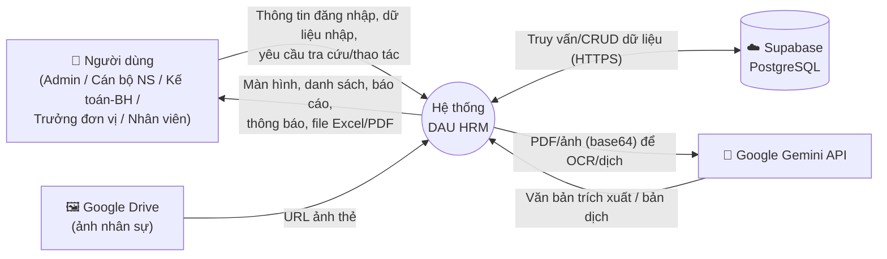
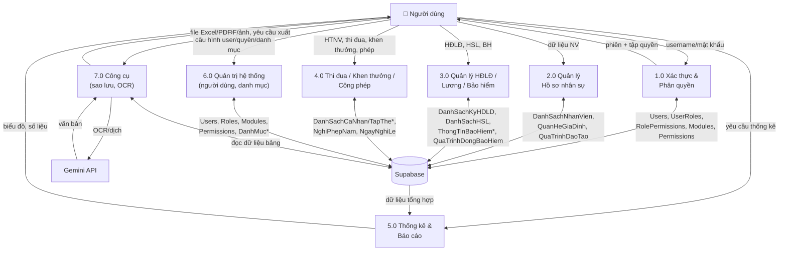
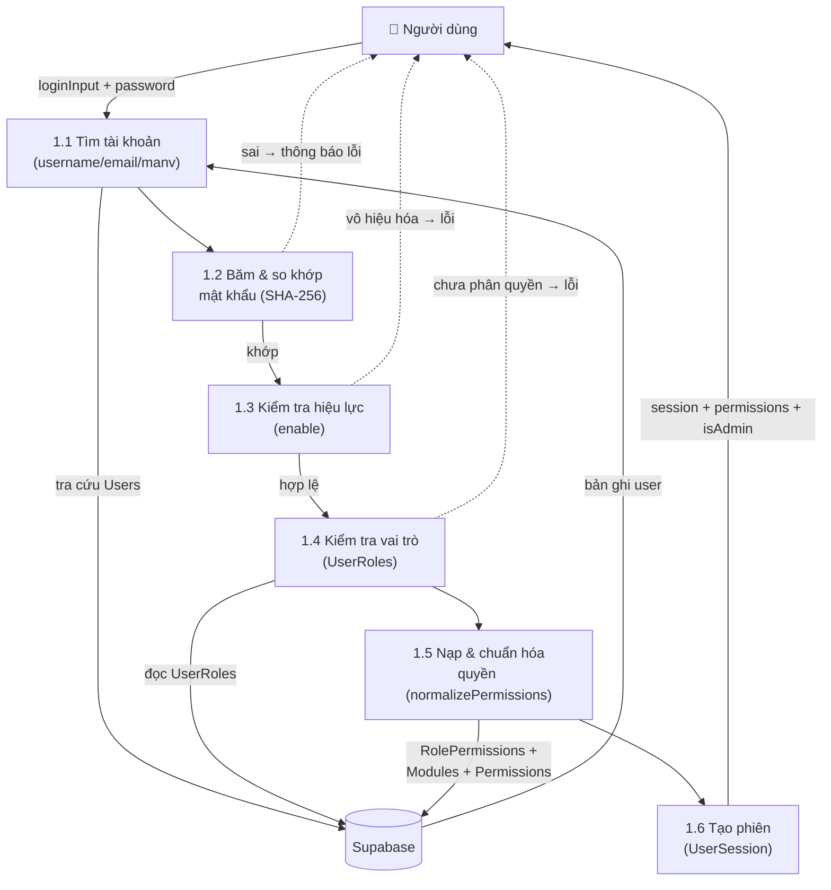
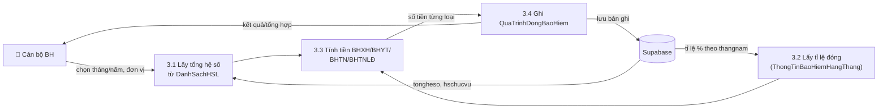

# DFD – SƠ ĐỒ LUỒNG DỮ LIỆU
## Hệ thống Quản lý Nhân sự – Trường Đại học Kiến trúc Đà Nẵng

| | |
|---|---|
| **Mã tài liệu** | DFD-DAU-HRM-05 |
| **Phiên bản** | 1.0 |
| **Ngày** | 02/07/2026 |

---

## 1. DFD Mức 0 – Sơ đồ ngữ cảnh (Context Diagram)

Mô tả hệ thống như một tiến trình duy nhất và các thực thể ngoài.

## 2. DFD Mức 1 – Phân rã các tiến trình chính

## 3. DFD Mức 2 – Tiến trình 1.0 Xác thực & Phân quyền (chi tiết)

## 4. DFD Mức 2 – Tiến trình 3.x Tính bảo hiểm hằng tháng (minh họa)

## 5. Kho dữ liệu (Data Stores) chính

| Mã kho | Bảng | Tiến trình sử dụng |
|--------|------|--------------------|
| D1 | Users, Roles, UserRoles, Modules, Permissions, RolePermissions | 1.0, 6.0 |
| D2 | DanhSachNhanVien, DanhSachQuanHeGiaDinh, DanhSachQuaTrinhDaoTao | 2.0, 5.0 |
| D3 | DanhSachKyHDLD, DanhMucHDLD | 3.0, 5.0 |
| D4 | DanhSachHSL, DanhMucHSL, DanhSachNghiKhongLuong | 3.0, 5.0 |
| D5 | ThongTinBaoHiemHangThang, ThongTinBaoHiemCaNhan, QuaTrinhDongBaoHiem, DanhMucBenhVien | 3.0 |
| D6 | DanhSachCaNhan/TapThe HTNV/DHTD/KhenThuong | 4.0, 5.0 |
| D7 | DanhSachNghiPhepNam, DanhSachNgayNghiLe | 4.0 |
| D8 | DanhMuc* (trình độ, chức danh, chức vụ, phòng ban, năm học, tổ bộ môn, ngành ĐT) | mọi tiến trình (nhãn/nghiệp vụ) |

## 6. Nhận xét luồng dữ liệu

- Mọi luồng dữ liệu đi **trực tiếp** giữa client và Supabase (không qua backend trung gian). Điều này đơn giản hóa kiến trúc nhưng đặt gánh nặng bảo mật lên cấu hình Supabase (RLS).
- Luồng OCR (7.0 → Gemini) là luồng ra bên ngoài duy nhất mang nội dung tài liệu; cần kiểm soát dữ liệu nhạy cảm gửi đi.
- Dữ liệu danh mục (D8) được đọc lặp lại ở nhiều tiến trình để dựng nhãn – ứng viên tốt cho caching.

---
*Xem tiếp: BPMN/Flowchart (`06-BPMN-Flowchart-Quy-Trinh.md`).*
