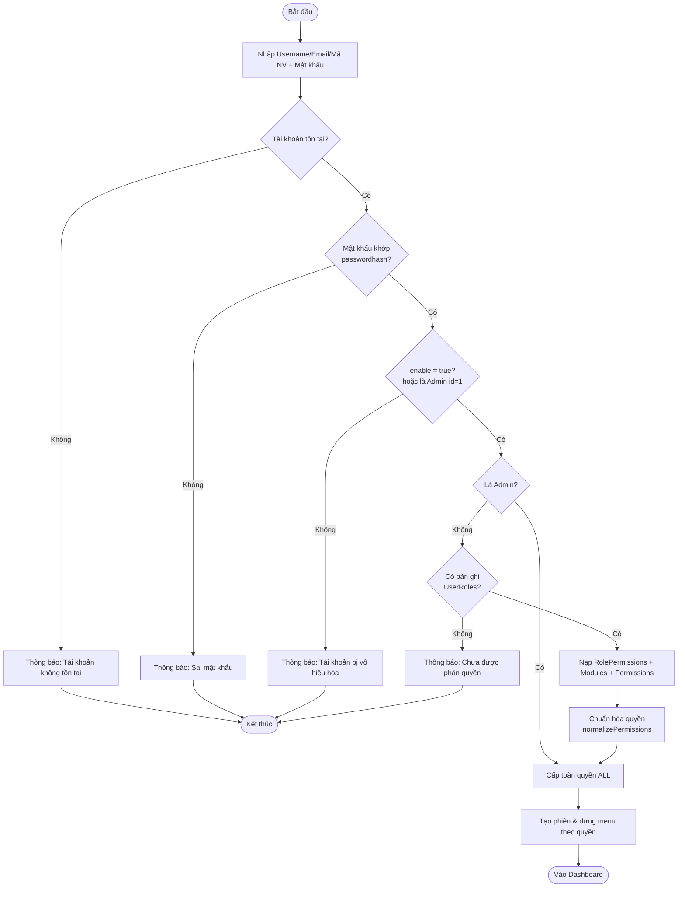
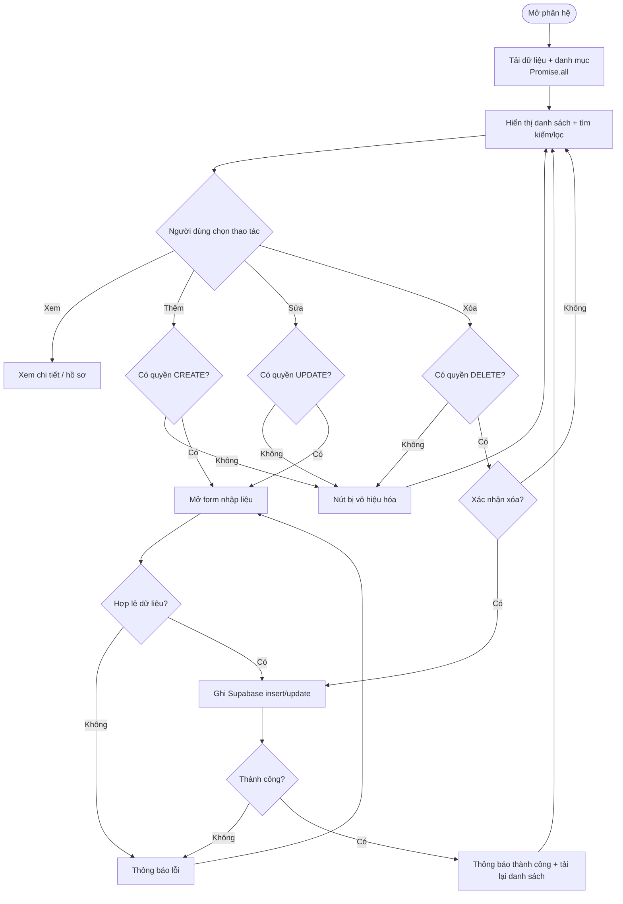
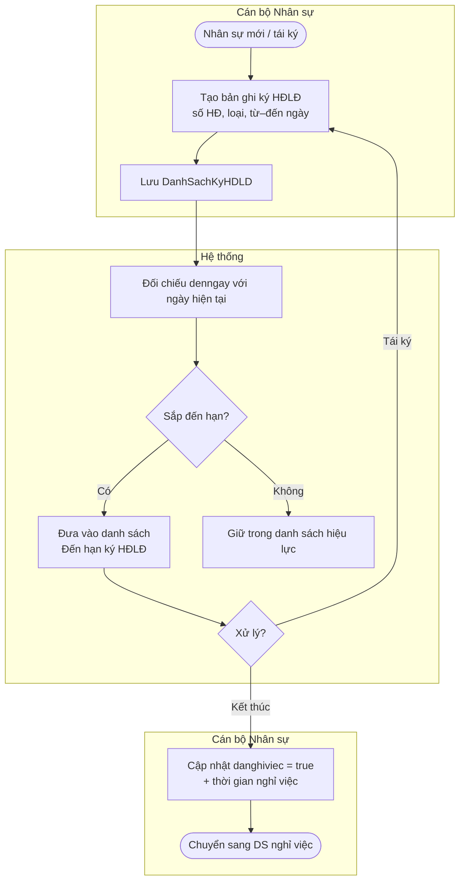
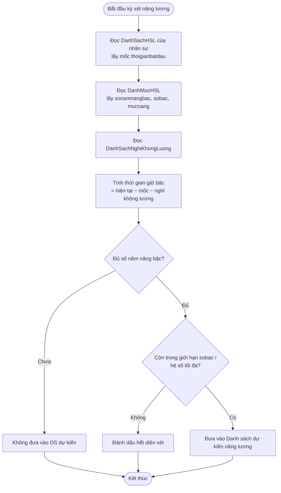
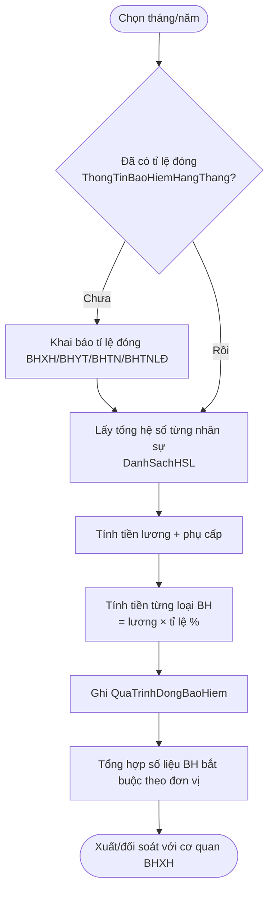
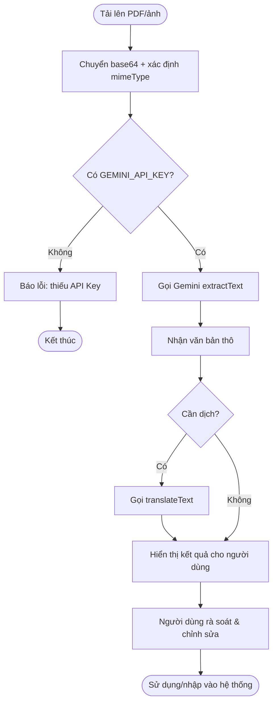
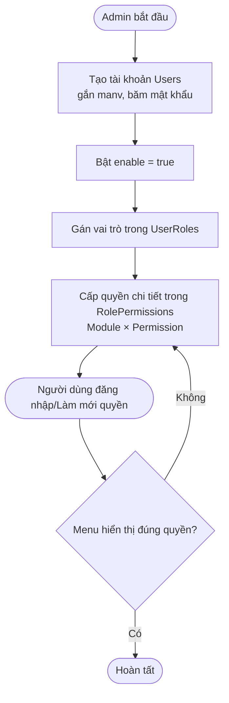

# BPMN / FLOWCHART – SƠ ĐỒ QUY TRÌNH NGHIỆP VỤ
## Hệ thống Quản lý Nhân sự – Trường Đại học Kiến trúc Đà Nẵng

| | |
|---|---|
| **Mã tài liệu** | BPMN-DAU-HRM-06 |
| **Phiên bản** | 1.0 |
| **Ngày** | 02/07/2026 |

---

## 1. Quy trình Đăng nhập & Kiểm soát truy cập (Flowchart)

## 2. Quy trình CRUD chuẩn có kiểm soát quyền (áp dụng cho mọi phân hệ)

## 3. Quy trình Quản lý Hợp đồng lao động & cảnh báo đến hạn (BPMN dạng lane)

## 4. Quy trình Nghiệp vụ Lương – Dự kiến nâng lương

## 5. Quy trình tính & tổng hợp Bảo hiểm hằng tháng

## 6. Quy trình Trích xuất dữ liệu bằng AI (OCR)

## 7. Quy trình Phân quyền người dùng mới (Admin)

## 8. Nhận xét về quy trình

- **Điểm kiểm soát quyền** xuất hiện đồng nhất ở mọi phân hệ (mục 2) — đây là điểm mạnh về tính nhất quán trải nghiệm; tuy nhiên kiểm soát nằm ở client (khuyến nghị bổ sung ở tầng DB, xem RISK-T03).
- Các quy trình đến-hạn (HĐLĐ, nâng lương) hiện dựa trên **so sánh chuỗi ngày** — nên chuẩn hóa kiểu ngày để tính toán chính xác.
- Quy trình có "điểm dừng con người" (rà soát OCR, xác nhận xóa, xử lý đến hạn) giúp giảm rủi ro sai sót tự động.

---
*Xem tiếp: Wireframe/Prototype (`07-Wireframe-Prototype.md`).*
