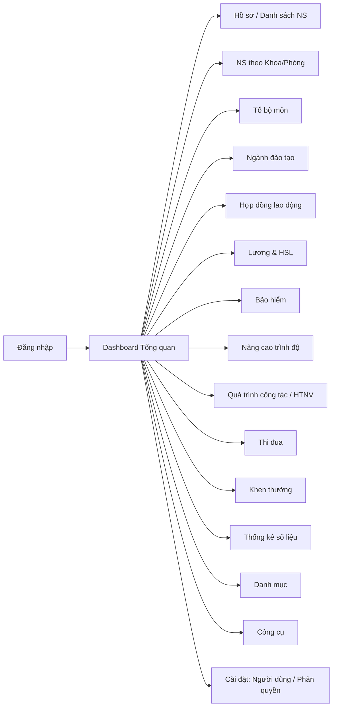

# WIREFRAME / PROTOTYPE – MÔ HÌNH GIAO DIỆN & TRẢI NGHIỆM
## Hệ thống Quản lý Nhân sự – Trường Đại học Kiến trúc Đà Nẵng

| | |
|---|---|
| **Mã tài liệu** | WF-DAU-HRM-07 |
| **Phiên bản** | 1.0 |
| **Ngày** | 02/07/2026 |

---

## 1. Nguyên tắc thiết kế giao diện (đúc kết từ mã nguồn)

- **Bố cục 2 phần**: Sidebar điều hướng (bên trái, nền xanh `blue-900`) + vùng nội dung (bên phải).
- **Hệ màu**: Xanh dương chủ đạo (`#195de6`, `blue-900`), điểm nhấn đỏ (`red-600`) cho tiêu đề trường, xanh lá cho trạng thái tích cực.
- **Thành phần lặp lại**: thẻ thống kê (stat card), bảng danh sách, modal (form nhập, chi tiết, thông báo, đổi mật khẩu).
- **Phản hồi người dùng**: modal thông báo thành công/lỗi thống nhất; hiệu ứng `animate-in zoom-in`, `Loader` khi tải.
- **Icon**: bộ `lucide-react` gắn ngữ nghĩa từng menu.
- **Responsive**: ẩn/hiện panel theo breakpoint `lg`; hỗ trợ dark-mode ở màn đăng nhập.

## 2. Sơ đồ điều hướng (Navigation Map)



## 3. Wireframe – Màn hình Đăng nhập

```
┌───────────────────────────────┬───────────────────────────────────┐
│                               │                     [? Hỗ trợ] [VN] │
│   [ảnh nền toà nhà + overlay] │  ┌─────────────────────────────┐   │
│                               │  │ [LOGO]  BỘ GIÁO DỤC & ĐÀO TẠO│   │
│   🎓                          │  │         Trường ĐH Kiến trúc  │   │
│   Quản lý nhân sự             │  │         Đà Nẵng             │   │
│   Hiệu quả & Chuyên nghiệp    │  ├─────────────────────────────┤   │
│                               │  │  ▣ Hệ thống Quản lý Nhân sự │   │
│   Hệ thống HRM tích hợp...    │  │  Đăng nhập                  │   │
│                               │  │                             │   │
│                               │  │  Username / Email / Mã NV   │   │
│                               │  │  [__________________] 👤    │   │
│                               │  │  Mật khẩu                   │   │
│                               │  │  [__________________] 👁     │   │
│                               │  │  ☐ Ghi nhớ    Quên mật khẩu?│   │
│                               │  │  [    Đăng nhập  →      ]    │   │
│                               │  └─────────────────────────────┘   │
│                               │  © 2024 DAU • Version 2.4.0        │
└───────────────────────────────┴───────────────────────────────────┘
```
**Tương tác**: nút con mắt ẩn/hiện mật khẩu; "Hỗ trợ/Quên mật khẩu" mở modal liên hệ Admin (email `tuanha@dau.edu.vn`, tel `0903586563`); lỗi hiển thị qua modal thông báo.

## 4. Wireframe – Bố cục Dashboard tổng thể

```
┌──────────────────┬─────────────────────────────────────────────────┐
│  QUẢN LÝ         │  BỘ GIÁO DỤC VÀ ĐÀO TẠO                          │
│  NHÂN SỰ         │  Trường ĐH Kiến trúc Đà Nẵng   👤{Tên} 🛡Làm mới│
│                  │                          🔑Đổi PW  ⏻Thoát        │
│  ▸ Hệ thống      ├─────────────────────────────────────────────────┤
│    • Hồ sơ CN    │                                                 │
│    • DS Nhân sự  │            [ VÙNG NỘI DUNG ĐỘNG ]               │
│    • DS Khoa/Phg │      (đổi theo activeMenuItem: dashboard,       │
│    ▸ Tổ bộ môn   │       danh sách, form, thống kê, công cụ...)    │
│    ▸ Ngành ĐT    │                                                 │
│    ▸ HĐLĐ        │                                                 │
│    ▸ Lương & HSL │                                                 │
│    ▸ Bảo hiểm    │                                                 │
│    • Nâng cao TĐ │                                                 │
│    ▸ QT công tác │                                                 │
│    ▸ Thi đua     │                                                 │
│    ▸ Khen thưởng │                                                 │
│    ▸ Thống kê    │                                                 │
│    ▸ Danh mục    │                                                 │
│    ▸ Công cụ     │                                                 │
│    ▸ Cài đặt     │                                                 │
└──────────────────┴─────────────────────────────────────────────────┘
```
**Ghi chú UX**: Menu đa cấp (accordion, mũi tên ⌄ xoay khi mở). Mục không có quyền bị **mờ (opacity-50) và không bấm được**. Sidebar cuộn độc lập (`scrollbar-hide`). Menu "DS Khoa/Phòng" sinh động theo các đơn vị **có nhân sự > 0**.

## 5. Wireframe – Dashboard Tổng quan (DashboardOverview)

```
Thông tin đội ngũ nhân sự
┌─────────┬─────────┬──────────────┬───────────────┬──────────┐
│ Tổng NS │ Số đơn  │ Giới tính    │ Tỉ lệ giảng   │ Trạng    │
│  {N} 👥 │ vị {U}🏠│ Nam{M} Nữ{F} │ viên {x}% ▓▓░ │ thái ❤   │
└─────────┴─────────┴──────────────┴───────────────┴──────────┘
┌───────────────────┬──────────────────────────────────────────┐
│ Thống kê Chức danh│ Thống kê Trình độ                        │
│  Giáo sư   {gs} 💎│  [TS {ts}] [ThS {ths}] [ĐH {dh}]         │
│  P.Giáo sư {pgs}🏆│  [CĐ {cd}] [Khác {khac}]                 │
│                   │  ▓▓▓▓▓░░░ thanh tỉ lệ phân bố trình độ    │
└───────────────────┴──────────────────────────────────────────┘
┌──────────────────────────────────────────────────────────────┐
│ Danh sách nhân sự mới nhất                                    │
│ Mã | Họ tên | Ngày sinh | Trình độ | Email | ĐT | Đơn vị | 👁 │
│ ...(3 dòng mới nhất, nút "Xem chi tiết" mở modal hồ sơ)...    │
└──────────────────────────────────────────────────────────────┘
```

## 6. Wireframe – Trang danh sách nghiệp vụ (mẫu chung CRUD)

```
┌──────────────────────────────────────────────────────────────┐
│ {Tiêu đề phân hệ}                       [🔍 Tìm kiếm____]     │
│                        [+ Thêm mới] [⭳ Xuất Excel]           │
├──────────────────────────────────────────────────────────────┤
│ # | Cột 1 | Cột 2 | Cột 3 | ... | Thao tác                   │
│ 1 | ...   | ...   | ...   |     | [✎ Sửa] [🗑 Xóa]           │
│ 2 | ...   | ...   | ...   |     | [✎ Sửa] [🗑 Xóa]           │
│ ...                                                          │
├──────────────────────────────────────────────────────────────┤
│                                        [◀ Trang ▶]           │
└──────────────────────────────────────────────────────────────┘
  ▲ Nút [+Thêm]/[✎Sửa]/[🗑Xóa] bị ẩn/vô hiệu nếu thiếu quyền
```

## 7. Wireframe – Modal Form nhập liệu & Modal Chi tiết hồ sơ

```
   MODAL FORM (Thêm/Sửa)              MODAL HỒ SƠ CHI TIẾT
┌────────────────────────┐      ┌───────────────────────────────────┐
│ ▣ {Tiêu đề}        [✕] │      │ 📄 Hồ sơ chi tiết nhân sự     [✕] │
├────────────────────────┤      ├───────────┬───────────────────────┤
│ Nhãn 1  [__________]   │      │ ┌───────┐ │ ▎THÔNG TIN CÁ NHÂN    │
│ Nhãn 2  [__________]   │      │ │ ẢNH   │ │  Họ lót | Tên | GT    │
│ Nhãn 3  [__ dropdown ▾]│      │ │ THẺ   │ │  Ngày sinh | Nơi sinh │
│ ...                    │      │ └───────┘ │ ▎CÔNG TÁC & TỔ CHỨC   │
├────────────────────────┤      │           │  Khoa/Phòng|Chức vụ.. │
│      [⭳ Lưu] [✕ Hủy]  │      │           │ ▎THÔNG TIN LIÊN HỆ    │
└────────────────────────┘      │           │  CCCD | ĐT | Email    │
                                ├───────────┴───────────────────────┤
                                │ Mã NV: {manv}        [Đóng hồ sơ] │
                                └───────────────────────────────────┘
```

## 8. Wireframe – Modal Thông báo & Đổi mật khẩu

```
   THÔNG BÁO (success/error)        ĐỔI MẬT KHẨU
┌──────────────────────┐      ┌────────────────────────────┐
│ ✔/⚠  Thông báo       │      │ ▣ Thay đổi Password    [✕] │
├──────────────────────┤      ├────────────────────────────┤
│   {nội dung thông báo}│      │ Mật khẩu cũ     [________] │
│                      │      │ Mật khẩu mới    [________] │
├──────────────────────┤      │ Xác nhận mới    [________] │
│        [ Đóng ]      │      ├────────────────────────────┤
└──────────────────────┘      │   [⭳ Lưu thay đổi] [✕ Hủy]│
                              └────────────────────────────┘
```

## 9. Phân tích trải nghiệm người dùng (UX)

**Điểm mạnh:**
- Điều hướng tập trung, phân nhóm nghiệp vụ rõ ràng; menu phản ánh trực tiếp quyền hạn (mục mờ khi không có quyền).
- Mẫu thao tác nhất quán trên mọi phân hệ (tìm kiếm – thêm – sửa – xóa – xuất) giảm chi phí học.
- Phản hồi tức thời qua modal, có trạng thái tải, xác nhận trước hành động phá hủy.
- Thẻ thống kê trực quan hóa số liệu đội ngũ ngay trang chủ.

**Điểm cần cải thiện (khuyến nghị):**
- **Mất phiên khi tải lại trang** (state trong bộ nhớ) → nên lưu phiên (localStorage/Supabase Auth).
- Thông báo lỗi đăng nhập/đổi mật khẩu **gộp chung** ("sai mật khẩu cũ hoặc mới không hợp lệ") → khó chẩn đoán; nên tách rõ.
- Chưa có phân trang/tải lười thống nhất cho danh sách lớn.
- Đa ngôn ngữ mới ở mức nút "VN" (chưa hoàn thiện i18n).
- Cần chuẩn hóa định dạng ngày (dd-mm-yyyy) đồng nhất toàn hệ thống.
- Khả năng tiếp cận (a11y): cần bổ sung nhãn ARIA, thứ tự tab, tương phản màu ở một số nhãn nhỏ.

---
*Xem tiếp: RTM (`08-RTM-Ma-Tran-Truy-Vet.md`).*
